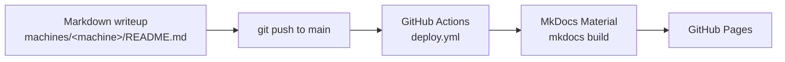

# HTB Writeups

Writeups of **Hack The Box** machines (Starting Point and retired), documented step by step.

🌐 **Website:** https://sprombash.github.io/htb-writeups/
💼 **LinkedIn:** www.linkedin.com/in/tecen-diaz

> Publishable content only. No real flags, hashes or passwords — always `<REDACTED>` or the location.

## Machines

| Machine | Difficulty | OS | Key techniques | Date |
|---|---|---|---|---|
| [Responder](machines/responder/) | Very Easy (SP) | Windows | LFI · NTLM capture · WinRM | 2026-11 |

## How it works

The website is not edited by hand: it is **generated** from the Markdown writeups in this
repository and redeployed automatically on every push.



### Technical decisions

| Decision | Why |
|---|---|
| **MkDocs Material** | Search, light/dark theme, syntax highlighting, copy buttons and table of contents come built in — configured, not coded. |
| **Writeups at the repo root** (`docs_dir: machines`) | GitHub and the website read the same files. One source of truth, no duplicated content. |
| **No `nav:` in the config** | MkDocs builds the menu from the folder structure, so adding `machines/<machine>/` is enough for it to appear on the site. |
| **Tags plugin** | Each writeup declares OS, difficulty and type in its front matter; the tags page groups them automatically. |
| **GitHub Actions deployment** | Publishing needs no manual step: the push *is* the release. |

### Problems solved while building it

- **Python and Git not recognized on Windows** — after installing with `winget`, the open
  terminal didn't see the new PATH, and a Microsoft Store alias hijacked `python`.
  Fixed by reopening the terminal and using the `py -m` launcher.
- **Icons rendered as raw text** (`:fontawesome-brands-github:`) — the `pymdownx.emoji`
  extension with Material's icon index was missing.
- **Workflows failing in 5 seconds** — the job annotation showed the account was locked
  by billing: $0 Actions budgets were blocking usage and couldn't be removed without a
  payment method. After adding one and deleting the budget, deployment worked.
  *Lesson: read the job annotations before touching the config.*

### Repository structure

```
htb-writeups/
├── machines/                  # website source (docs_dir)
│   ├── index.md               # home page (grid and stats are generated)
│   ├── about.md               # about page
│   ├── tags.md                # tag index
│   ├── how-it-works.md        # this explanation, on the website
│   └── <machine>/
│       ├── README.md          # writeup (front matter: title, tags, date, techniques)
│       └── images/
├── hooks/machines.py          # build hook: front matter → machine grid, stats, Ctrl+K index
├── overrides/                 # Material template overrides + design CSS/JS
├── mkdocs.yml                 # site configuration
├── requirements.txt           # mkdocs-material
├── .github/workflows/deploy.yml
└── CLAUDE.md                  # rules for the publishing agent
```

### Adding a new machine

1. Create `machines/<machine>/README.md` with its front matter (`title`, `tags`,
   `date`, `techniques`).
2. Check it locally with `py -m mkdocs build --strict` (it warns if a tag is missing).
3. `git add`, `git commit`, `git push` — GitHub Actions does the rest: the machine shows
   up on the home grid, the stats and the Ctrl+K palette by itself.

---
_Educational documentation. All work done in authorized lab environments._
