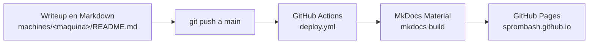

# Cómo está hecha esta web

Esta web no se edita a mano: se **genera sola** a partir de los writeups en Markdown
del repositorio. Cada vez que subo una máquina nueva, la web se reconstruye y se
publica automáticamente.

## El flujo

1. Escribo el writeup en Markdown dentro de `machines/<maquina>/`.
2. Hago `git push` a la rama `main`.
3. GitHub Actions detecta el push y ejecuta el workflow `deploy.yml`.
4. El workflow instala MkDocs Material y construye la web estática.
5. El resultado se publica en GitHub Pages. En 1-2 minutos la máquina aparece aquí.

## Decisiones técnicas

| Decisión | Por qué |
|---|---|
| **MkDocs Material** como generador | Buscador, tema claro/oscuro, resaltado de sintaxis, botón de copiar código e índice automático vienen de serie: se configuran, no se programan. |
| **Writeups en la raíz** (`docs_dir: machines`) | GitHub y la web leen exactamente los mismos archivos. Una sola fuente de verdad, sin duplicar contenido. |
| **Sin `nav:` en la configuración** | MkDocs genera el menú desde la estructura de carpetas. Añadir `machines/<maquina>/` basta para que aparezca en la web. |
| **Etiquetas** (plugin `tags`) | Cada writeup declara SO, dificultad y tipo en su cabecera; la página de etiquetas los agrupa sola. |
| **GitHub Actions** para desplegar | Publicar no requiere ningún paso manual: el push es la publicación. |

## Problemas que resolví al montarla

- **Python y Git no se reconocían en Windows.** Tras instalarlos con `winget`, la
  terminal abierta no veía el PATH nuevo, y un alias de Microsoft Store secuestraba
  el comando `python`. Solución: reabrir la terminal y usar el lanzador `py -m`.
- **Iconos que salían como texto** (`:fontawesome-brands-github:`). Faltaba activar la
  extensión `pymdownx.emoji` con el índice de iconos de Material.
- **Los workflows fallaban en 5 segundos.** La anotación del job decía que la cuenta
  estaba bloqueada por facturación: había presupuestos de Actions a $0 que bloqueaban
  el uso y no se podían quitar sin un método de pago. Tras añadirlo y eliminar el
  presupuesto, el despliegue funcionó. *Lección: leer siempre las anotaciones del job
  antes de tocar la configuración.*

## Añadir una máquina nueva

1. Crear `machines/<maquina>/README.md` con su cabecera (`title` y `tags`).
2. Añadir una fila a la tabla de la portada.
3. `git add`, `git commit` y `git push`. El resto es automático.

El código completo está en el
[repositorio](https://github.com/SPROMbash/htb-writeups).
